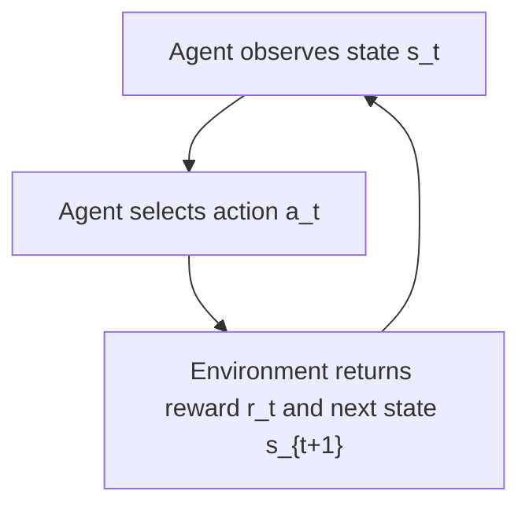
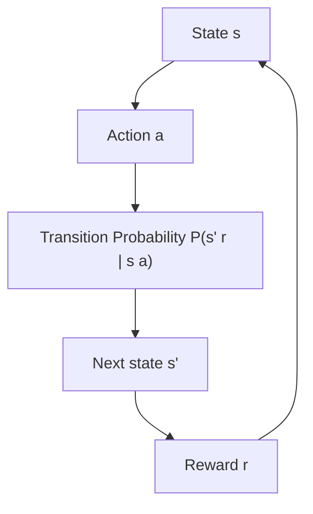
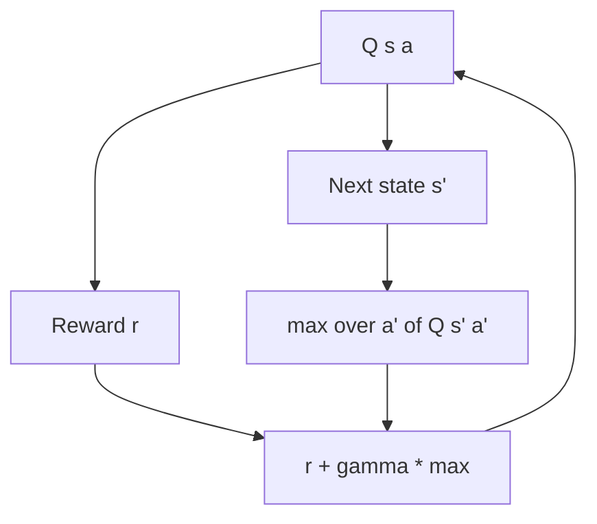

# What is LLD (Low Level Design)

Duration: 17:18
URL: https://www.youtube.com/watch?v=mQM3V8E13yc

# Reinforcement Learning – Comprehensive Technical Notes

## 1. Introduction to Reinforcement Learning

Reinforcement Learning (RL) is a branch of machine learning where an **agent** learns to make decisions by interacting with an **environment**. The agent receives feedback in the form of **rewards** or **penalties** and aims to learn a strategy (policy) that maximizes the cumulative reward over time.

Unlike supervised learning (which relies on labeled input‑output pairs) and unsupervised learning (which finds hidden patterns without labels), RL is centered around **trial‑and‑error learning** and **delayed feedback**.

### Real‑World Use Cases

| Domain | Example |
|--------|---------|
| Robotics | Teaching a robot to walk or grasp objects |
| Game AI | AlphaGo, DQN playing Atari games |
| Recommendation systems | Optimizing long‑term user engagement |
| Autonomous driving | Lane keeping, overtaking, traffic negotiation |
| Resource management | Cooling in data centers, inventory control |
| Finance | Portfolio optimization, algorithmic trading |

---

## 2. Core Concepts

The following building blocks form the foundation of any RL problem.

- **Agent** – The learner / decision‑maker (e.g., a robot, a game character).
- **Environment** – The world the agent interacts with; it responds to actions and produces new states and rewards.
- **State (s)** – A representation of the environment’s current situation. Can be fully or partially observable.
- **Action (a)** – A choice that the agent can make at a given state.
- **Reward (r)** – A scalar feedback signal from the environment. The agent’s goal is to maximise the sum of rewards over time.
- **Policy (π)** – The agent’s strategy mapping states to actions. Deterministic: π(s) = a; Stochastic: π(a|s) = probability of taking a in state s.
- **Value Function (V or Q)** – Predicted future cumulative reward from a state (or state‑action pair). V(s) = expected return from state s; Q(s,a) = expected return after taking action a in state s.
- **Model of the environment** – A representation that predicts next state and reward given current state and action (used in model‑based RL).

### Agent‑Environment Interaction Loop

---

## 3. Markov Decision Process (MDP) – Mathematical Framework

Almost all RL problems can be formalised as a **Markov Decision Process**. An MDP is defined by the tuple **(S, A, P, R, γ)**.

- **S** – Set of all possible states.
- **A** – Set of all possible actions.
- **P** – State transition probability: P(s', r | s, a) = probability of ending in state s' with reward r after taking action a in state s.
- **R** – Reward function: expected immediate reward R(s, a, s').
- **γ** – Discount factor (0 ≤ γ ≤ 1): balances immediate vs. future rewards.

**Markov property:** The future depends only on the current state and action, not on the past history.

### MDP Transition Diagram

---

## 4. Key Principles

### 4.1 Exploration vs. Exploitation

The agent must **explore** the environment to discover high‑reward actions and **exploit** its current knowledge to maximise reward.

| Strategy | Description |
|----------|-------------|
| ε‑greedy | With probability ε take a random action (explore); with 1‑ε take the best known action (exploit). |
| Upper Confidence Bound (UCB) | Choose actions that have high uncertainty (potential upside). |
| Thompson sampling | Sample from a posterior distribution over action values. |

### 4.2 Credit Assignment Problem

When a reward is received after many steps, it is difficult to determine which previous actions contributed to it. RL algorithms (e.g., eligibility traces, temporal difference learning) solve this by propagating credit backwards through time.

### 4.3 Reward Hypothesis

“All goals can be described by the maximisation of expected cumulative reward.” – This is the central assumption of RL.

---

## 5. Bellman Equations

Bellman equations express the relationship between the value of a state (or state‑action pair) and the values of successor states.

### 5.1 State‑Value Function V(s)
Expected return starting from state s and following policy π.

**Bellman expectation equation for V:**
Vπ(s) = Σa π(a|s) Σs',r P(s',r|s,a) [ r + γ Vπ(s') ]

### 5.2 Action‑Value Function Q(s,a)
Expected return starting from state s, taking action a, then following policy π.

**Bellman expectation equation for Q:**
Qπ(s,a) = Σs',r P(s',r|s,a) [ r + γ Σa' π(a'|s') Qπ(s',a') ]

### 5.3 Bellman Optimality Equations (for the optimal policy π*)

V*(s) = maxa Σs',r P(s',r|s,a) [ r + γ V*(s') ]

Q*(s,a) = Σs',r P(s',r|s,a) [ r + γ maxa' Q*(s',a') ]

### Backup Diagram for Q‑value Update

---

## 6. Categorization of RL Methods

### 6.1 Model‑based vs. Model‑free

| Aspect | Model‑based | Model‑free |
|--------|-------------|-------------|
| Learns environment dynamics? | Yes (transition & reward) | No |
| Sample efficiency | Higher (plans with learned model) | Lower (needs many interactions) |
| Computational cost | Higher (planning step) | Lower (direct policy/value learning) |
| Examples | Dyna‑Q, AlphaZero | Q‑learning, PPO |

### 6.2 On‑policy vs. Off‑policy

- **On‑policy** – Learns the same policy that is used for exploration (e.g., SARSA).
- **Off‑policy** – Learns a target policy from data generated by a different behaviour policy (e.g., Q‑learning).

### 6.3 Value‑based vs. Policy‑based vs. Actor‑Critic

| Type | What is learned | Examples | Pros / Cons |
|------|----------------|----------|--------------|
| Value‑based | Value function (V or Q); policy derived implicitly | Q‑learning, DQN | Sample‑efficient, but can be unstable in continuous action spaces |
| Policy‑based | Direct policy parameterisation (πθ) | REINFORCE, PPO | Works well in continuous actions, but high variance |
| Actor‑Critic | Both value function (critic) and policy (actor) | A2C, A3C, SAC | Combines strengths: lower variance, stable |

---

## 7. Classic Algorithms

### 7.1 Q‑learning (Off‑policy, Temporal Difference)

Update rule for Q(s,a):
Q(s,a) ← Q(s,a) + α [ r + γ maxa' Q(s',a') – Q(s,a) ]

- Uses the **maximum** over next action values → off‑policy.
- Simple, robust, but can overestimate Q‑values.

### 7.2 SARSA (On‑policy)

Update rule:
Q(s,a) ← Q(s,a) + α [ r + γ Q(s',a') – Q(s,a) ]

- Uses the action a' actually taken by the current policy → on‑policy.
- Safer during training (avoids overestimation), but may learn a suboptimal policy if exploration is aggressive.

### 7.3 Deep Q‑Network (DQN)

Combines Q‑learning with deep neural networks. Two key innovations:

- **Experience replay** – Stores transitions (s, a, r, s') in a buffer; samples mini‑batches randomly to break correlation.
- **Target network** – A separate network with frozen parameters that is periodically updated to stabilise learning.

### 7.4 Policy Gradients (REINFORCE)

Parameterise policy πθ(a|s). Update θ by ascending the gradient:
∇θ J(θ) = Eπ [ ∇θ log πθ(a|s) * Gt ]

where Gt is the cumulative return from time t. High variance but simple.

### 7.5 Actor‑Critic (A2C / A3C)

- **Actor** – Policy πθ(a|s)
- **Critic** – Value function Vφ(s) or Qφ(s,a)
- The advantage A(s,a) = Q(s,a) – V(s) (or its estimate) reduces variance.

### 7.6 Proximal Policy Optimization (PPO)

A modern, stable policy gradient method. It clips the policy update to prevent destructively large changes. Often the go‑to algorithm for continuous control tasks.

---

## 8. Training Process and Challenges

### Typical RL Training Loop

1. Initialise policy and/or value function parameters.
2. For each episode:
   - Reset environment, observe initial state.
   - For each step until terminal:
     - Choose action using current policy (with exploration).
     - Execute action, observe reward and next state.
     - Store transition (experience replay buffer if used).
     - Update policy / value function (e.g., with TD error).
3. Repeat until convergence or performance plateau.

### Common Challenges

| Challenge | Description | Mitigation |
|-----------|-------------|-------------|
| Sparse rewards | Agent receives reward only at the end of long episodes | Reward shaping, hierarchical RL, curiosity‑driven exploration |
| Sample inefficiency | RL often needs millions of environment steps | Model‑based RL, efficient off‑policy algorithms |
| Deadly triad | Combination of function approximation, bootstrapping, and off‑policy learning can cause divergence | Target networks, experience replay, constrained optimisation |
| Overestimation bias | Q‑learning tends to overestimate action values | Double Q‑learning, clipped double Q (TD3) |
| Catastrophic forgetting | Neural networks forget previous experiences | Prioritised replay, multi‑task learning |

---

## 9. Practical Implementation Considerations

### Environments

- **OpenAI Gym** – Standardised API for many simulated environments (CartPole, MountainCar, Atari).
- **Unity ML‑Agents** – 3D physics‑based environments for robotics and games.
- **PettingZoo** – Multi‑agent RL environments.

### Hyperparameters (Critical for Success)

| Hyperparameter | Typical range | Effect |
|----------------|---------------|--------|
| Learning rate α | 1e-4 to 1e-2 | Too high → instability; too low → slow convergence |
| Discount factor γ | 0.9 to 0.99 | Lower γ favours short‑term rewards |
| ε in ε‑greedy | 0.01 to 0.2 | Decay over time to shift from exploration to exploitation |
| Batch size | 32 to 256 | Larger batches stabilise updates |
| Experience replay size | 1e5 to 1e6 | Larger buffer stores more diverse data |

### Evaluation Metrics

- **Episode return** – Cumulative reward per episode (smoothed over recent episodes).
- **Success rate** – For goal‑oriented tasks.
- **Convergence speed** – Steps to reach a performance threshold.
- **Stability** – Variance of returns across runs.

---

## 10. Interview‑Relevant Insights

### Common Interview Questions

1. **What is the difference between Q‑learning and SARSA?**  
   - Q‑learning is off‑policy (uses max over next actions), SARSA is on‑policy (uses actual next action). Q‑learning can be more aggressive; SARSA is safer when exploration is high.

2. **How does the discount factor γ affect learning?**  
   - γ=0 makes the agent greedy (only immediate rewards). γ close to 1 makes the agent far‑sighted but can increase variance. In infinite‑horizon problems, γ < 1 ensures finite returns.

3. **Explain the exploration‑exploitation dilemma.**  
   - The agent must try unknown actions to discover high rewards (exploration) while using known good actions to maximise reward (exploitation). Pure exploitation leads to suboptimal policies; pure exploration wastes time.

4. **What is the “deadly triad” and why is it dangerous?**  
   - The combination of (1) function approximation, (2) bootstrapping (TD learning), and (3) off‑policy learning can cause divergence or instability in value estimates. Many modern algorithms (e.g., DQN, PPO) use techniques like target networks or trust regions to mitigate this.

5. **When would you choose policy‑based over value‑based methods?**  
   - Policy‑based methods excel in continuous action spaces, when the optimal policy is stochastic, or when the environment is partially observable. Value‑based methods are often more sample‑efficient in discrete, low‑dimensional action spaces.

### Key Takeaways for Practitioners

- **Start simple** – Use a tabular Q‑learning or a small DQN before scaling to complex algorithms.
- **Normalise observations and rewards** – Greatly improves stability, especially for neural network function approximators.
- **Monitor learning curves** – Look for increasing returns, but also check for plateauing or collapse.
- **Reproducibility matters** – Fix random seeds, report hyperparameters, and run multiple seeds.
- **Domain knowledge helps** – Reward shaping, curriculum learning, or using a known policy as a baseline can drastically speed up learning.

### Edge Cases to Remember

- **POMDP (Partially Observable MDP)** – When the agent cannot observe the full state. Use recurrence (LSTM) or belief states.
- **Continuous action spaces** – Cannot use argmax over actions; use policy gradients or actor‑critic.
- **Large or infinite state spaces** – Function approximation (neural networks, tile coding) is mandatory.
- **Delayed rewards** – Credit assignment becomes very hard; consider temporal difference methods with eligibility traces (e.g., λ‑return).

---

## Summary Table of RL Algorithms

| Algorithm | On/Off Policy | Model‑Free | Value/Policy | Use Case |
|-----------|---------------|------------|--------------|----------|
| Q‑learning | Off | Yes | Value | Discrete actions, small state space |
| SARSA | On | Yes | Value | On‑policy safety, online learning |
| DQN | Off | Yes | Value | Atari, discrete action, raw pixels |
| REINFORCE | On | Yes | Policy | Simple policy gradient, continuous actions |
| A2C / A3C | On | Yes | Actor‑Critic | General purpose, stable training |
| PPO | On | Yes | Actor‑Critic | Most modern continuous control tasks |
| Dyna‑Q | Off | No | Value | When an accurate environment model is cheap |

---

